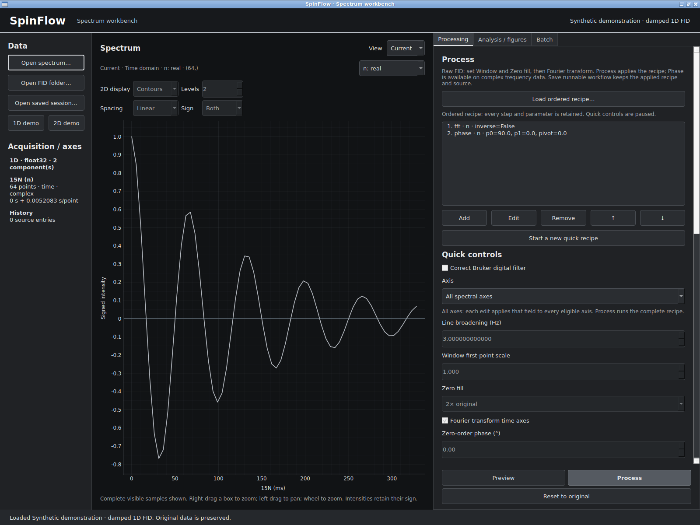
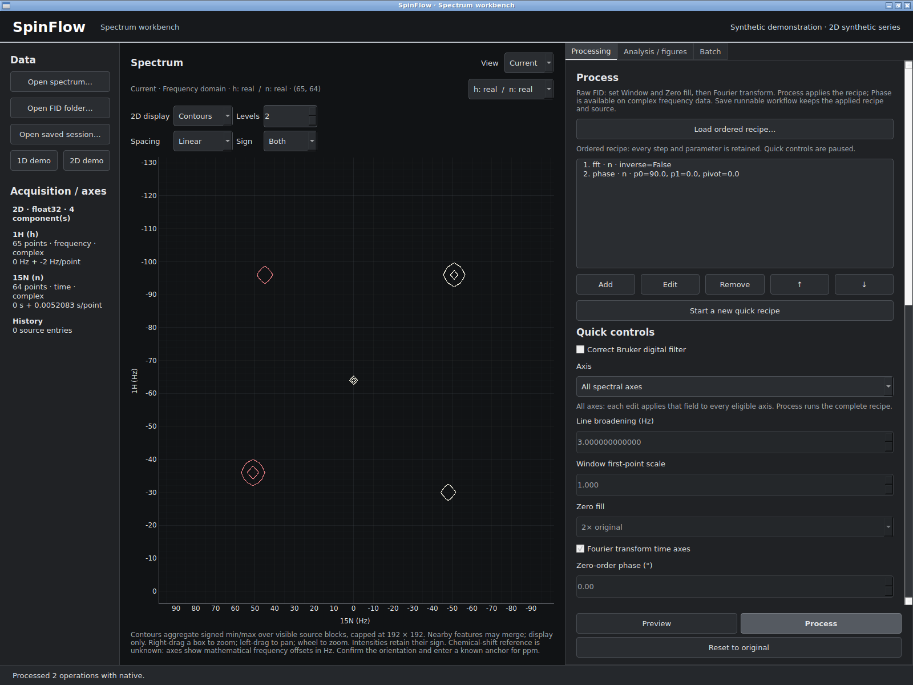
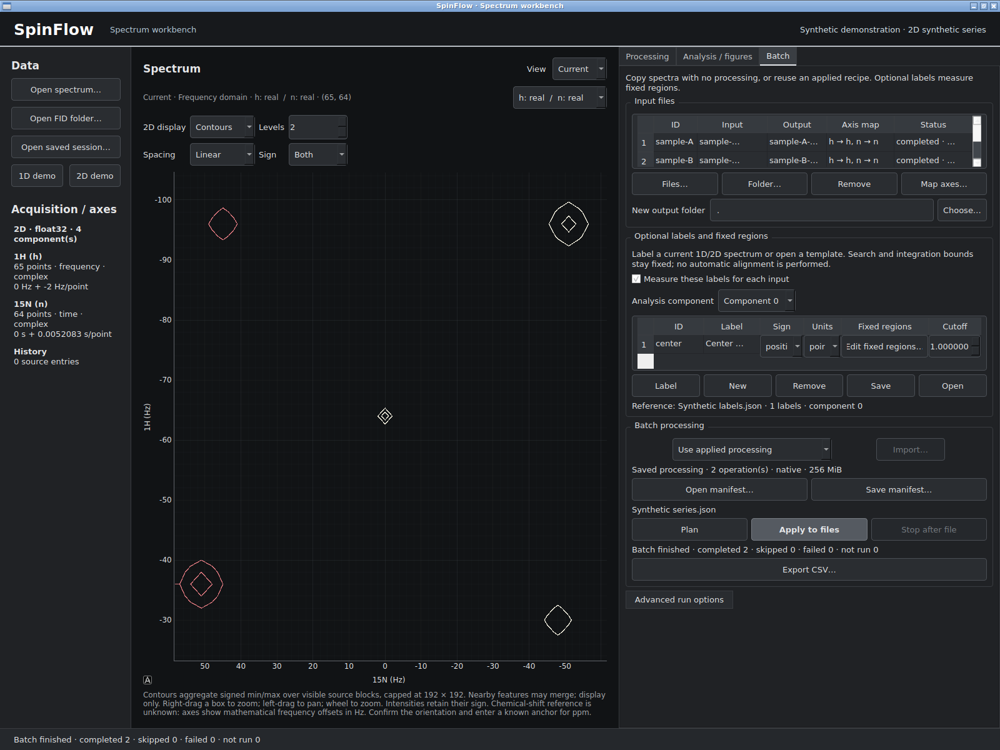
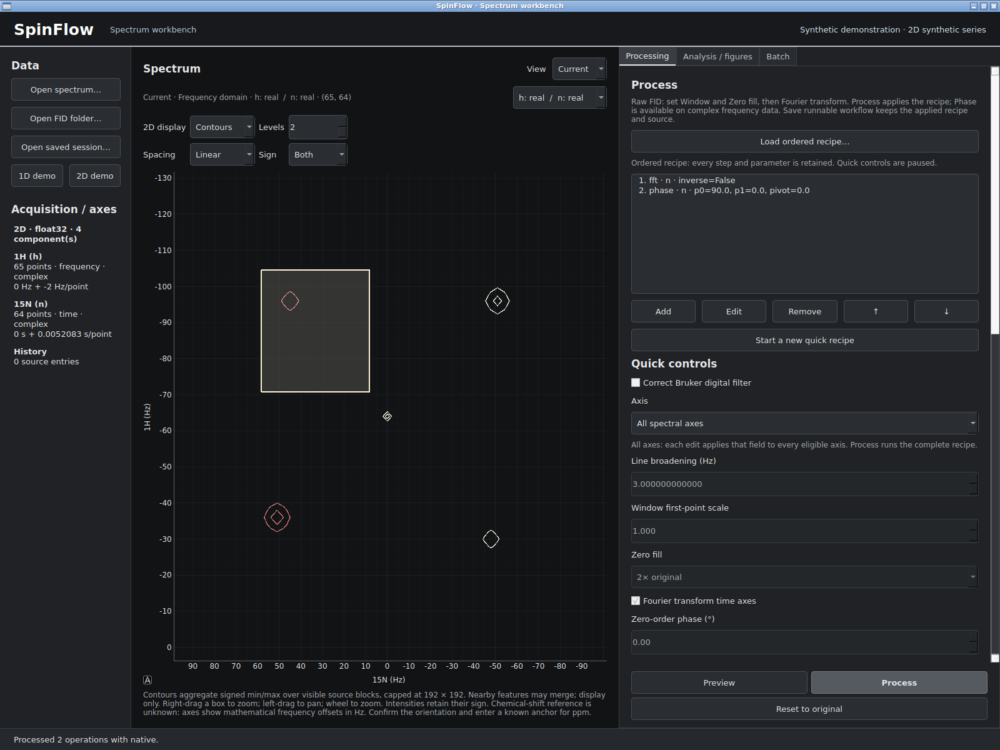

# SpinFlow 0.4.0b2 development GUI

Automated Linux X11 synthetic demonstrations: [source9c09e89](https://github.com/ben-shin/spinflow/commit/9c09e89ae1d2928097640f8c55451c6916ed5b53), [CI43348788727](https://github.com/ben-shin/spinflow/actions/runs/43348788727). Unreleased development build, not scientific or researcher acceptance. Numeric result tables and exported scientific figures are not shown.

[Ubuntu trial handout](../../researcher-handoff-0.4.0b2.md).

Demonstration data · development build. Synthetic damped 1D FID in time domain, with the ordered FFT/phase recipe and processing controls visible.

Demonstration data · development build. Synthetic 2D data shown with positive and negative contour rings in Hz; chemical-shift reference is explicitly unknown.

Demonstration data · development build. Two synthetic batch items completed; optional fixed-region label, axis mapping and run status are visible. Numeric heights and volumes are not shown here.

Demonstration data · development build. The right-drag zoom box is visible over synthetic 2D contours; this is a GUI demonstration, not scientific validation.
